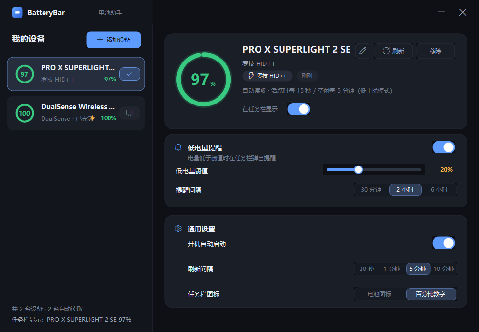
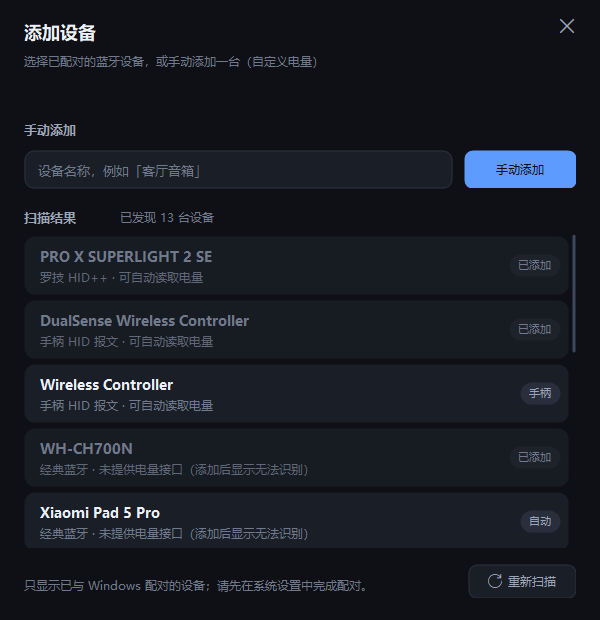
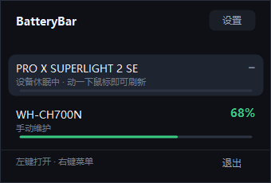
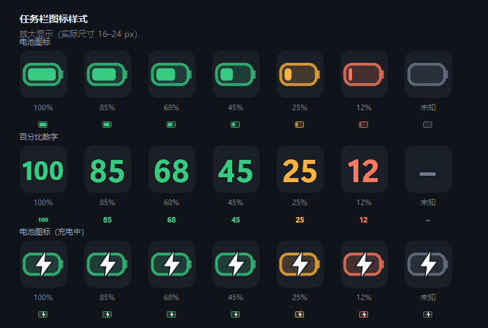

# BatteryBar · 电池助手

在 Windows 任务栏里随时看到无线设备（蓝牙耳机、鼠标、键盘、手柄……）的剩余电量，
电量过低时自动弹卡片提醒，并支持开机自动运行。

- 单文件绿色程序：`BatteryBar.exe`（约 470 KB），基于 .NET Framework 4.8（Windows 10/11 自带，无需安装任何运行库）
- 进程常驻内存约 20 MB（私有）/ 45 MB（工作集），空闲时 CPU 占用接近 0
- 纯本地运行，不联网、不上传任何数据



| 添加设备 | 托盘面板 |
| --- | --- |
|  |  |

---

## 一、安装与卸载

### 安装（推荐）

右键 `install.ps1` → **使用 PowerShell 运行**，或在本目录打开 PowerShell 执行：

```powershell
powershell -ExecutionPolicy Bypass -File .\install.ps1
```

脚本会：

1. 把程序复制到 `%LOCALAPPDATA%\Programs\BatteryBar\BatteryBar.exe`
2. 在桌面和开始菜单建立快捷方式
3. 启动程序

> 也可以直接把 `BatteryBar.exe` 复制到任意目录双击运行。
> 如果双击没有反应，通常是安全软件拦截了受保护文件夹中的新程序，用上面的安装脚本装到用户目录即可。

### 卸载

```powershell
powershell -ExecutionPolicy Bypass -File .\uninstall.ps1
```

脚本会结束进程、删除开机启动项与快捷方式、删除安装目录，并询问是否同时删除配置。

---

## 二、快速上手

1. **首次运行**：主窗口打开后自动注册开机启动（可在「通用设置」里关闭）。
2. **添加设备**：点击左上角 **＋ 添加设备**
   - 列表会自动列出**已与 Windows 配对的设备**（请先在「设置 → 蓝牙和设备」里完成配对）
   - 也可以用「手动添加」自定义任意名字的设备，自己维护电量
3. **选择任务栏显示哪台设备**：
   - 在左侧设备卡片右侧点击小图标，或
   - 在右侧详情卡片里打开「在任务栏显示」开关
4. **低电量提醒**：默认低于 20% 时提醒，可在「低电量提醒」里调整阈值与提醒间隔。
5. 关闭主窗口只会**隐藏**，程序继续在托盘运行；右键托盘图标可退出。


---

## 三、任务栏图标

程序在托盘（系统托盘 / 通知区域）显示一个电量图标，两种样式任选：

- **电池图标**：电池形状 + 实际电量填充，绿 / 琥珀 / 红三色分级
- **百分比数字**：直接显示 `85`、`12` 这类数字



> Windows 11 默认会把新程序的图标收进「隐藏的图标」小箭头里。
> 把它固定出来：**设置 → 个性化 → 任务栏 → 其他系统托盘图标 → 打开 BatteryBar**，
> 或用鼠标把图标从「^」弹层拖到任务栏上。

交互：

| 操作 | 效果 |
| --- | --- |
| 左键单击图标 | 弹出设备电量小面板（可点选某台设备显示到任务栏） |
| 右键单击图标 | 菜单：切换显示设备 / 添加设备 / 设置 / 开机自启 / 退出 |
| 双击图标 | 打开主窗口 |

---

## 四、电量是怎么读出来的

程序用一套**通用识别流程**：按设备类型依次尝试所有已知读取方式，成功即记住；全部失败就明确显示「无法识别」，
不需要为每个新型号改代码，也不再要求手动填写电量。

| 读取方式 | 适用设备 | 说明 |
| --- | --- | --- |
| **蓝牙 GATT** | 蓝牙低功耗（BLE）设备：新款无线鼠标、键盘、耳塞、手环等 | 读标准电池服务 `0x180F / 0x2A19`，需要设备连接/在范围内 |
| **罗技 HID++** | 任意罗技无线接收器（Lightspeed / Unifying / Bolt）下的设备 | 依次尝试统一电量 `0x1004` → 电量状态 `0x1000` → 电压 `0x1001` → HID++ 1.0 寄存器 `0x0D/0x07`；并用 `0x0005` 读真实设备名 |
| **手柄 HID 报文** | PS5 DualSense / Edge、PS4 DualShock 4 | 主输入报文里带电量：DualSense 蓝牙 `0x31` 第 54 字节 / USB `0x01` 第 53 字节（低 4 位档位、高 4 位充电状态） |
| **通用 HID 电量** | 其它实现了 HID 标准 `Generic Device Controls(0x06) / Battery Strength(0x20)` 的 HID 设备 | 按 HID 报告描述符自动查找电量字段，型号无关 |
| **BLE 广播** | 苹果 AirPods / Beats、小米 / Redmi 等 TWS 耳机 | Apple Continuity `0x004C/0x07` 与 Google Fast Pair `0xFE2C` 的电量字节，由随程序打包的 `tools\BleAgent` 扫描（自带运行库，**不需要装 Python**） |
| **无法识别** | 以上都不支持的设备（例如经典蓝牙耳机） | 显示「无法识别」，不再提供手动填写 |

程序内置一张**设备族预设表**（罗技 / PS 手柄 / Xbox / Sony 耳机 / Apple 耳机 / 小米耳机 / HFP 耳机…）：
命中预设但当前版本还没实现对应协议时，界面会直接告诉你「需要什么协议」，而不是笼统的无法识别。
详见 [docs/device-presets.md](docs/device-presets.md)。

**充电状态**：能读到充电状态的设备（罗技、手柄、HID 电量）会额外显示一个 **⚡ 闪电标志**，
主界面、设备列表、托盘弹出面板和任务栏图标上都会出现。

> 无线鼠标休眠时不会回应查询，程序会保留上一次读数并显示「设备休眠中 · 上次 xx%」，
> 动一下鼠标或等下一次刷新就会自动恢复，不会把任务栏电量变成「–」。

---

## 五、设置项说明

| 设置 | 作用 |
| --- | --- |
| 低电量阈值 | 5%–50%，低于该值时提醒 |
| 提醒间隔 | 同一台设备两次提醒的最小间隔：30 分钟 / 2 小时 / 6 小时 |
| 开机自动启动 | 写入当前用户注册表 `HKCU\...\CurrentVersion\Run`，登录后自动以托盘方式启动 |
| 刷新间隔 | 30 秒 / 1 分钟 / 5 分钟 / 10 分钟。间隔越长越省电（BLE 读取会唤醒蓝牙连接） |
| 任务栏图标 | 电池图标 / 百分比数字 |
| 在任务栏显示 | 该设备是否作为托盘图标的数据来源（同时只有一台） |

配置文件：`%APPDATA%\BatteryBar\config.json`（删除它即可恢复默认）。

---

## 六、常见问题

**Q：添加设备列表是空的？**
A：列表只显示**已配对**的设备。请先在系统设置里配对，再点「重新扫描」。

**Q：图标不见了 / 没在任务栏显示电量？**
A：图标默认被折叠进「^ 隐藏的图标」，按第三节的方法固定即可。

**Q：某台设备显示「无法识别」？**
A：说明这台设备没有提供任何标准电量接口（经典蓝牙耳机最典型）。这不是配置问题，任何软件都读不到；程序会如实标注「无法识别」。

**Q：为什么鼠标偶尔显示「休眠中」？**
A：无线鼠标为省电会进入休眠，休眠时不回应电量查询。程序会保留上次读数，动一下鼠标或等下一轮刷新即可恢复。

**Q：新买的设备要改代码吗？**
A：不需要。发现设备时会自动按 蓝牙 GATT / 罗技 HID++ / 手柄报文 / 通用 HID 电量 依次尝试，能读就读，读不到就标「无法识别」。

**Q：会不会很费电 / 占资源？**
A：私有内存约 20 MB，空闲 CPU 接近 0；建议把刷新间隔设为 5 或 10 分钟。

**Q：支持 Windows 10 吗？**
A：支持 Windows 10 1809 及以上、Windows 11。界面圆角在 Win11 下更精致。

---

## 七、源码与构建

源码位于 `app/src`，用系统自带编译器构建，无需安装 Visual Studio / .NET SDK：

```powershell
powershell -ExecutionPolicy Bypass -File .\app\build.ps1
# 产物：dist\BatteryBar.exe
```

| 文件 | 内容 |
| --- | --- |
| `Theme.cs` / `Controls.cs` | 配色、字体、自绘控件（开关、分段选择、滑杆、设备卡片） |
| `Native.cs` / `Providers.cs` | SetupAPI、HID、蓝牙 GATT、罗技 HID++ 的电量读取 |
| `Discovery.cs` | 已配对蓝牙设备 / BLE 接口 / 罗技接收器扫描 |
| `MainForm.cs` / `Dialogs.cs` | 主界面、添加设备、托盘面板、低电量卡片 |
| `TrayIcon.cs` / `Preview.cs` | 多尺寸图标渲染与预览图生成 |
| `Model.cs` / `TrayApp.cs` | 配置持久化、轮询、提醒、开机自启、单实例 |

---

## 附：与罗技 G HUB / Logi Options+ 共存（低干扰模式）

罗技官方软件和本程序会同时轮询同一个 HID++ 通道，两边的请求可能互相打断应答
（例如接收器回一帧 `0x0F` 填充的无效数据，会被读成 15%）。因此：

- 程序启动后会自动检测 `lghub.exe / Logi Options+` 等进程；
- 检测到它们时，罗技设备自动进入**低干扰模式**：轮询间隔提升到 10 分钟、不做唤醒重试、
  不再做多接收器/多 index 试探，界面上会标注「（低干扰模式）」；
- 需要立即刷新时点「刷新」按钮即可（手动刷新不受限）。

如果 G HUB 曾经显示过错误的 15%，重启一次 G HUB（或拔插接收器）即可恢复正常。